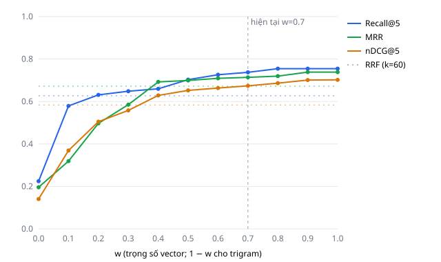

# Kết quả thực nghiệm trọng số Hybrid RAG

- Thời điểm chạy: 2026-11-14 12:05
- Số câu có đoạn liên quan: **29** / 59; câu không nên trích dẫn (lạc đề hoặc kho không có tài liệu): 30
- Chỉ số chọn w tốt nhất: `ndcg@k`, k = 5

| Cấu hình | Recall@k | MRR | nDCG@k |
|---|---|---|---|
| Pure Trigram (w=0.0) | 0.225 | 0.196 | 0.141 |
| Hybrid w=0.1 | 0.579 | 0.319 | 0.369 |
| Hybrid w=0.2 | 0.631 | 0.497 | 0.505 |
| Hybrid w=0.3 | 0.648 | 0.585 | 0.558 |
| Hybrid w=0.4 | 0.660 | 0.692 | 0.629 |
| Hybrid w=0.5 | 0.703 | 0.699 | 0.652 |
| Hybrid w=0.6 | 0.726 | 0.709 | 0.663 |
| Hybrid w=0.7 ← hiện tại | 0.737 | 0.714 | 0.674 |
| Hybrid w=0.8 | 0.755 | 0.719 | 0.686 |
| Hybrid w=0.9 | 0.755 | 0.738 | 0.701 |
| Pure Vector (w=1.0) ★ tốt nhất | 0.755 | 0.738 | 0.702 |
| RRF (k=60) | 0.627 | 0.672 | 0.584 |

**Kết luận tự động:** w tốt nhất theo ndcg@k = **1.0** (0.702); w hiện tại 0.7 đạt 0.674. Cân nhắc đổi `W_VECTOR` trong `services/retrieval.py` theo kết quả này (nhớ kiểm tra độ chênh có đáng kể không với cỡ mẫu hiện tại).

### Kiểm định paired bootstrap (ndcg@k, 10.000 lần lấy mẫu, CI 95%)

| So sánh | Hiệu TB | CI 95% | Có ý nghĩa? |
|---|---|---|---|
| w=1.0 vs w=0.7 | +0.028 | [+0.002, +0.071] | Có |
| w=0.7 vs RRF | +0.090 | [+0.024, +0.159] | Có |

### Câu không dấu (ndcg@k từng câu)

| Câu | w=0.0 | w=0.7 | w=1.0 |
|---|---|---|---|
| q34: acid uric cao an gi | 0.000 | 0.000 | 0.000 |
| q35: tieu duong kieng an gi | 0.195 | 0.000 | 0.000 |
| q51: bi gut co an duoc hai san khong | 0.000 | 0.000 | 0.000 |

## Ngưỡng MIN_SCORE

Điểm top-1 hybrid (w=0.7) - câu có đoạn liên quan: min 0.255 / TB 0.459; câu không nên trích dẫn: max 0.525 / TB 0.366.

Ngưỡng tốt nhất theo F1: **0.41** (P=0.786, R=0.759, F1=0.772); ngưỡng hiện tại 0.35. Chi tiết: `min_score_sweep.csv`.
