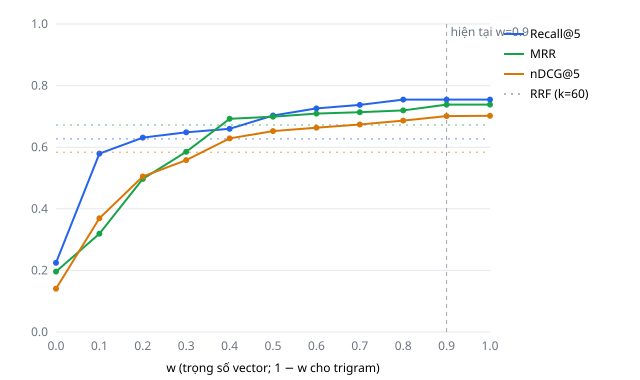

# Tổng kết Giai đoạn 2 - Guardrails và thực nghiệm trọng số 0.7/0.3

> Dự án NutriSmart Agent - Nhóm E15 · Cập nhật 17/11/2026
> Nhánh code: `feature/guardrails-rag-eval` (chờ merge sau PR `feature/mobile-plan-activity-sync`)

Giai đoạn 2 trả lời trực tiếp hai nhận xét của hội đồng:

| Nhận xét | Giải pháp đã làm |
|---|---|
| "Cần Warning System cảnh báo rủi ro" | Warning Engine rule-based chạy sau mọi đầu ra AI |
| "Tỷ lệ 0.7 và 0.3 chưa rõ ràng" | Thực nghiệm quét trọng số trên dữ liệu thật, có kiểm định thống kê |

---

## 1. Warning Engine (hệ thống cảnh báo an toàn)

### 1.1. Nguyên tắc

- Là lớp **luật cố định (rule-based)**, chạy **sau** khi AI trả kết quả. Không nhờ AI tự kiểm tra chính nó.
- Áp dụng cho cả 3 đầu ra AI: **thực đơn lộ trình**, **kết quả quét ảnh món ăn**, **câu trả lời chat**.
- 3 mức cảnh báo, luôn nêu lý do cụ thể:
  - 🔴 **Nguy cơ** (DANGER): ví dụ "Món có 'tôm' - bạn khai báo dị ứng Hải sản có vỏ."
  - 🟡 **Lưu ý** (WARNING): ví dụ "Món có 'chè' - người đái tháo đường típ 2 nên hạn chế đường đơn."
  - 🔵 **Thông tin** (INFO): ví dụ "Câu trả lời không dựa trên tài liệu đã được chuyên gia duyệt."
- Luôn kèm câu miễn trừ: *NutriSmart chỉ hỗ trợ tham khảo, không thay thế chẩn đoán hay tư vấn của bác sĩ.*

### 1.2. Các tầng kiểm tra

| Tầng | Nội dung | Mức |
|---|---|---|
| Dị ứng | Bảng món → nguyên liệu → nhóm dị nguyên. Bắt dị ứng ẩn (mắm tôm, nước mắm, dầu hào, mayonnaise, xì dầu) và từ đồng nghĩa (tôm, tép, cua, ghẹ). Có danh sách loại trừ để tránh báo nhầm ("cà" khác "cá", "sữa đậu nành" không phải sữa bò, "bò bía", "mì Quảng", "cá nhân hóa"). | 🔴 |
| Bệnh nền | Gout, đái tháo đường típ 2, tăng huyết áp, rối loạn lipid máu, gan nhiễm mỡ, bệnh thận mạn. Mỗi luật ghi nguồn tham khảo. | 🟡 |
| Calo | Dưới mức tối thiểu theo giới tính (nữ 1.200, nam 1.500 kcal) → 🔴. Vượt 120% chỉ tiêu ngày → 🟡. Mức tối thiểu này cũng áp dụng khi hệ thống tự hạ calo sau mỗi chu kỳ đánh giá. | 🔴/🟡 |
| Độ tin cậy ảnh | ≥ 0,7: tự điền · 0,3-0,7: yêu cầu xác nhận · < 0,3: yêu cầu chụp lại. *(Đây là giả thuyết ban đầu, cần hiệu chỉnh ở GĐ3.)* | 🟡/🔴 |
| Chat | Câu trả lời nhắc tới dị nguyên của người dùng → 🟡. Không có trích dẫn tài liệu đã duyệt → 🔵. | 🟡/🔵 |

### 1.3. Kết quả đánh giá

Bộ **73 test case** (`backend/eval/guardrail_cases.json`), nhãn gán theo công thức phổ biến của món, viết **độc lập** với từ điển của hệ thống.

| Loại | Precision | Recall | Tỷ lệ báo động giả |
|---|---|---|---|
| Dị ứng | **1,000** | **0,711** | 0,000 |
| Bệnh nền | **1,000** | **0,867** | 0,000 |

Baseline "không có guardrail": recall = 0.

**Cách đọc:**
- Hệ thống **không báo nhầm lần nào**: mọi cảnh báo bật ra đều đúng.
- Hệ thống **bỏ sót 13/73 case**, đều là **dị ứng ẩn trong tên món**: bún bò Huế (mắm ruốc), bánh xèo (tôm), gỏi gà (lạc rang), bò lúc lắc (xì dầu có lúa mì)... Từ điển chỉ "nhìn thấy chữ", không biết công thức món.
- Nhóm **cố ý không chỉnh từ điển theo đúng 13 case này**, vì làm vậy là "học vẹt" trên bộ test và con số sẽ mất giá trị. Hướng khắc phục đúng là xây bảng món → nguyên liệu từ dữ liệu Viện Dinh dưỡng (GĐ1), rồi đo lại trên bộ case mới.

Chi tiết từng case: `backend/eval/results/guardrail_report.md`.

---

## 2. Thực nghiệm trọng số Hybrid RAG - "Tại sao 0.7 / 0.3?"

### 2.1. Câu hỏi nghiên cứu

Hệ thống tìm tài liệu bằng công thức:

```
điểm = w × (giống về ý nghĩa - vector bge-m3) + (1 - w) × (giống về chữ - trigram)
```

Code đang dùng **w = 0,7**, nhưng con số này được chọn theo cảm tính. Thực nghiệm quét w từ 0,0 đến 1,0 để xem giá trị nào tốt nhất.

> Lưu ý thuật ngữ: thành phần thứ hai là **trigram similarity (pg_trgm)**, không phải BM25.

### 2.2. Dữ liệu

- Kho tài liệu: **11 bài đã duyệt, 40 đoạn (chunk)**, về đái tháo đường, gout, tăng huyết áp, DASH, rối loạn lipid máu, thiếu máu, trào ngược dạ dày, uống nước.
- **59 câu hỏi tiếng Việt**:
  - 29 câu có đoạn trả lời được trong kho
  - 22 câu đúng chủ đề dinh dưỡng nhưng kho chưa có tài liệu
  - 8 câu lạc đề (giá vàng, thời tiết...)
  - 3 câu cố ý gõ không dấu
- Chỉ số đo: Recall@5, MRR, nDCG@5. So với Pure Vector, Pure Trigram và RRF (k=60).

### 2.3. Kết quả

| Cấu hình | Recall@5 | MRR | nDCG@5 |
|---|---|---|---|
| Pure Trigram (w=0,0) | 0,225 | 0,196 | 0,141 |
| Hybrid w=0,5 | 0,703 | 0,699 | 0,652 |
| **Hybrid w=0,7 (hiện tại)** | **0,737** | **0,714** | **0,674** |
| Hybrid w=0,8 | 0,755 | 0,719 | 0,686 |
| Hybrid w=0,9 | 0,755 | 0,738 | 0,701 |
| Pure Vector (w=1,0) | 0,755 | 0,738 | 0,702 |
| RRF (k=60) | 0,627 | 0,672 | 0,584 |



**Kiểm định paired bootstrap** (nDCG@5, 10.000 lần lấy mẫu, khoảng tin cậy 95%):

| So sánh | Chênh lệch | Khoảng tin cậy 95% | Có ý nghĩa thống kê? |
|---|---|---|---|
| w=1,0 so với w=0,7 | +0,028 | [+0,002 ; +0,071] | Có, nhưng sát ngưỡng |
| w=0,7 so với RRF | +0,090 | [+0,024 ; +0,159] | Có, rõ rệt |

**Câu gõ không dấu** (nDCG@5): cả 3 câu đều đạt **0** ở mọi cấu hình (trừ một câu đạt 0,195 khi chỉ dùng trigram).

**Ngưỡng lọc MIN_SCORE:** với w=0,7, ngưỡng tốt nhất theo F1 là **0,41** (P = 0,786, R = 0,759); code lúc đó dùng 0,35. Ngưỡng phụ thuộc w, xem mục 3.2 cho w=0,9.

### 2.4. Kết luận

1. **0.7 là lựa chọn hợp lý nhưng chưa tối ưu.** Điểm số tăng đều theo w và đạt đỉnh ở vùng 0,8-1,0.
2. **Hybrid tuyến tính tốt hơn RRF** một cách có ý nghĩa thống kê. Lựa chọn kiến trúc ban đầu là đúng.
3. **Trigram không giúp được câu gõ không dấu.** Giả thuyết "trigram chịu lỗi thiếu dấu" (lý do chính để giữ trọng số 0,3) không đúng với dữ liệu này. Hướng cải tiến: chuẩn hóa `unaccent` trước khi so trigram (repo đã có migration `13_unaccent.sql`).
4. Ngưỡng MIN_SCORE phải hiệu chỉnh cùng với w: 0,41 khi w=0,7; 0,51 khi w=0,9 (mục 3.2).

Báo cáo đầy đủ: `backend/eval/results/report.md`.

---

## 3. Quyết định của nhóm (17/11/2026)

### 3.1. Kiểm tra nhãn do AI gán

Nhóm chọn ngẫu nhiên 12/51 câu (seed=42) và đối chiếu với nội dung chunk trong DB
(`backend/scripts/verify_rag_labels.py`, kết quả ở `backend/eval/results/label_verification.md`).

- Kết quả ban đầu: **đồng thuận 10/12**, hai câu bị đánh "không đồng ý" là q03 và q14.
- **Cần xem lại hai câu này:** script kiểm tra chỉ hiển thị **400 ký tự đầu** mỗi chunk, trong khi
  thông tin trả lời của q03 và q14 nằm ở phía sau:

  | Câu | Chunk | Vị trí câu trả lời | Trích dẫn |
  |---|---|---|---|
  | q03 (tiểu đường ăn trái cây) | 102 | ký tự 2.743 | "Người bệnh đái tháo đường nên ăn trái cây và rau quả có lượng calo thấp..." |
  | | 104 | ký tự 2.252 | "...hoa quả ngọt (nhãn, vải, mít)..." (nhóm cần hạn chế) |
  | | 105 | ký tự 3.316 | "...ăn một bát nhỏ trái cây hoặc một miếng trái cây có chỉ số GI thấp..." |
  | q14 (vitamin C và hấp thu sắt) | 129 | ký tự 3.632 | "...chứa nhiều vitamin C giúp ... tăng cường hấp thu sắt" |
  | | 130 | ký tự 1.227 | "...thực phẩm giúp hấp thu sắt như các loại quả chứa nhiều vitamin C..." |
  | | 133 | ký tự 1.251 | "...kết hợp với các thực phẩm chứa nhiều vitamin C ... tăng khả năng hấp thụ sắt" |
  | | 134 | ký tự 1.418 | "...cùng với những thực phẩm chứa nhiều vitamin C ... cải thiện sự hấp thụ sắt" |

  Nếu nhóm đọc toàn văn và đồng ý, độ đồng thuận là **12/12 (100%)** và không cần sửa nhãn.
- Câu trích dẫn cho khóa luận (sau khi nhóm xác nhận lại):
  > *"Nhãn được gán bởi mô hình AI dựa trên trích dẫn; nhóm kiểm tra ngẫu nhiên 12/51 câu (seed=42)
  > bằng cách đối chiếu toàn văn đoạn tài liệu, đồng thuận 12/12."*
- Ghi chú q51 trong biên bản ("Trigram xử lý tốt không dấu") **mâu thuẫn với kết quả đo**: q51 đạt
  nDCG 0 ở mọi cấu hình (xem mục 2.3). Nên sửa ghi chú này trước khi trích vào khóa luận.
- Phát hiện phụ có giá trị: chunk đầu bài thường chứa sapo/mục lục, cần lọc khi index (đưa vào GĐ3).

### 3.2. Trọng số và ngưỡng

Nhóm chọn **đổi trọng số theo dữ liệu**: `W_VECTOR = 0.9`, `W_TRIGRAM = 0.1`.

| So sánh (nDCG@5) | Chênh lệch | CI 95% | Có ý nghĩa? |
|---|---|---|---|
| w=0.9 so với w=0.7 (cũ) | +0.028 | [+0.001 ; +0.070] | Có |
| w=1.0 so với w=0.9 | +0.001 | [+0.000 ; +0.003] | Không, nên giữ 0.9 là hợp lý |
| w=0.9 so với RRF | +0.117 | [+0.037 ; +0.211] | Có |

**Ngưỡng `MIN_SCORE` phải hiệu chỉnh lại theo w mới.** Tăng w làm điểm của cả kho tăng lên, nên
ngưỡng 0.41 (tính cho w=0.7) không dùng lại được:

| Ngưỡng (với w=0.9) | Precision | Câu trích dẫn sai / 30 | F1 |
|---|---|---|---|
| 0.35 (ban đầu) | 0.509 | 27 | 0.667 |
| 0.41 | 0.553 | 21 | 0.684 |
| **0.51 (đang dùng)** | **0.786** | **6** | **0.772** |

→ Cặp giá trị đang dùng trong code: **w = 0.9, MIN_SCORE = 0.51**.
Quy tắc cho sau này: **mỗi lần đổi `W_VECTOR` phải chạy lại sweep để chọn lại ngưỡng.**

## 4. Việc còn lại cho nhóm

- [x] **Việc 1:** kiểm tra 12 nhãn ngẫu nhiên (10/12, chờ xem lại q03, q14 bằng toàn văn)
- [ ] Xem lại q03, q14 với toàn văn chunk; sửa ghi chú q51 trong biên bản
- [x] **Việc 2:** đổi sang w=0.9, ngưỡng hiệu chỉnh lại thành 0.51
- [ ] **Đối chiếu nguồn y khoa** trong `backend/eval/sources.md`:
  - [ ] Đã xác minh số hiệu, cần mở bản gốc để ghi số trang/mục: QĐ 5481/QĐ-BYT (2020, ĐTĐ típ 2), QĐ 3192/QĐ-BYT (2010, THA), QĐ 2388/QĐ-BYT (2024, thận mạn), WHO (muối < 5 g/ngày), NHLBI (giảm cân 0,5-1 kg/tuần)
  - [ ] **Gout:** QĐ 361/QĐ-BYT (2014) có tồn tại nhưng **chưa xác nhận có chương bệnh gút**
  - [ ] **Rối loạn lipid máu:** mới thấy qua trích dẫn thứ cấp, cần bản gốc của Hội Tim mạch
  - [ ] **Gan nhiễm mỡ:** chưa có nguồn cụ thể
  - [ ] **Calo tối thiểu 1.200/1.500:** cần đối chiếu bài gốc AHA/ACC/TOS 2013 (Jensen et al., *Circulation* 2014)
- [ ] **Rà nhãn bộ test guardrail** (`guardrail_cases.json`), nhất là các món gắn ghi chú "dị ứng ẩn"
- [ ] (Tùy chọn) Bổ sung tài liệu cho các chủ đề kho chưa có (thận mạn, thai kỳ, loãng xương...) để tăng số câu đánh giá

---

## 5. Chạy lại thực nghiệm

Cần Postgres, Ollama (`bge-m3`) đang chạy. Chạy trong thư mục `backend/`:

```bash
# Đánh giá Warning Engine (không cần DB/AI)
PYTHONUTF8=1 ./.venv/Scripts/python.exe scripts/guardrail_eval.py

# Thực nghiệm trọng số RAG (sau khi sửa nhãn trong rag_questions.json)
PYTHONUTF8=1 ./.venv/Scripts/python.exe scripts/rag_weight_sweep.py sweep

# Toàn bộ test
PYTHONUTF8=1 ./.venv/Scripts/python.exe -m pytest tests -q
```

Kết quả ghi vào `backend/eval/results/`.

---

## 6. Bản đồ file

| File | Nội dung |
|---|---|
| `backend/app/services/guardrails.py` | Warning Engine: từ điển dị nguyên, luật bệnh nền, ngưỡng calo |
| `backend/app/services/guardrail_eval.py` | Tính precision/recall cho Warning Engine |
| `backend/app/services/rag_eval.py` | Chỉ số RAG, RRF, quét ngưỡng, paired bootstrap |
| `backend/scripts/guardrail_eval.py` | Chạy đánh giá guardrail → báo cáo |
| `backend/scripts/rag_weight_sweep.py` | Chạy thực nghiệm trọng số → báo cáo + biểu đồ |
| `backend/eval/guardrail_cases.json` | 73 test case guardrail |
| `backend/eval/rag_questions.json` | 59 câu hỏi RAG + nhãn + lý do |
| `backend/eval/sources.md` | Tình trạng kiểm chứng nguồn y khoa, lập luận ngưỡng cân nặng |
| `backend/eval/results/` | Báo cáo, CSV, biểu đồ kết quả |
| `frontend/src/components/WarningList.jsx` | Banner cảnh báo (Lộ trình, Quét món, Chat) |
| `frontend/src/components/MarkdownText.jsx` | Hiển thị câu trả lời AI dạng markdown |

### Thay đổi kèm theo trong GĐ2

- Chat hiển thị markdown (chữ đậm, danh sách) thay vì lộ dấu `**`.
- Giới hạn độ dài câu trả lời chat tăng từ 250 lên 700 token (chỉnh được qua `OLLAMA_CHAT_NUM_PREDICT`), tránh câu trả lời bị cắt cụt.
- Thay toàn bộ dấu gạch ngang dài bằng dấu "-".
- Banner cảnh báo dùng nền đặc, dễ đọc trên ảnh nền.
- Test backend: **316 passed**.
